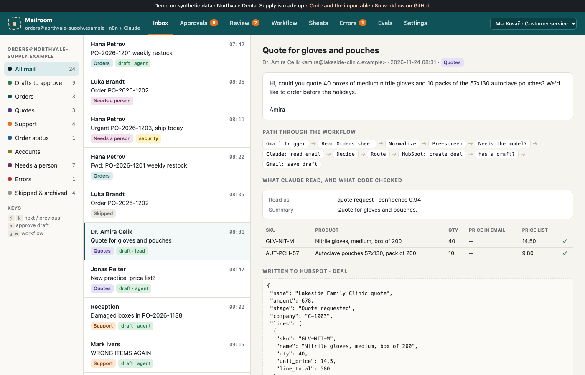
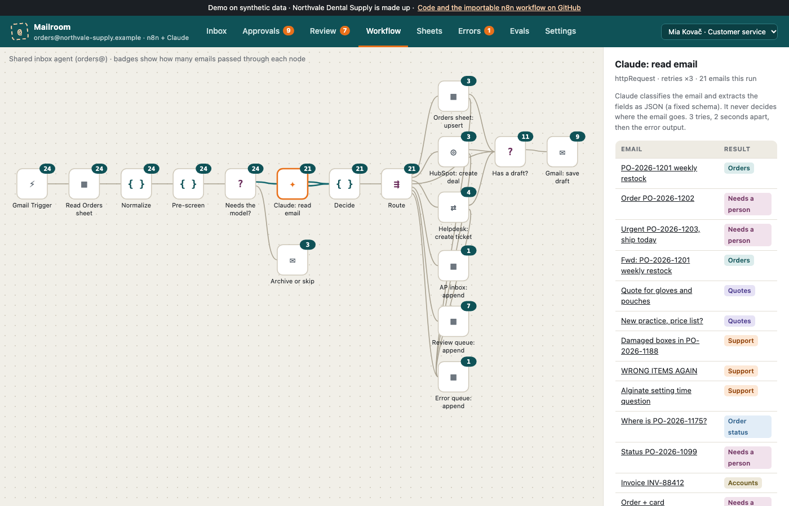
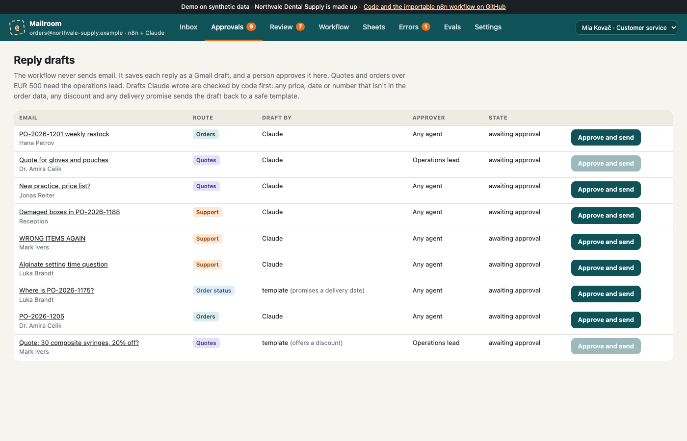
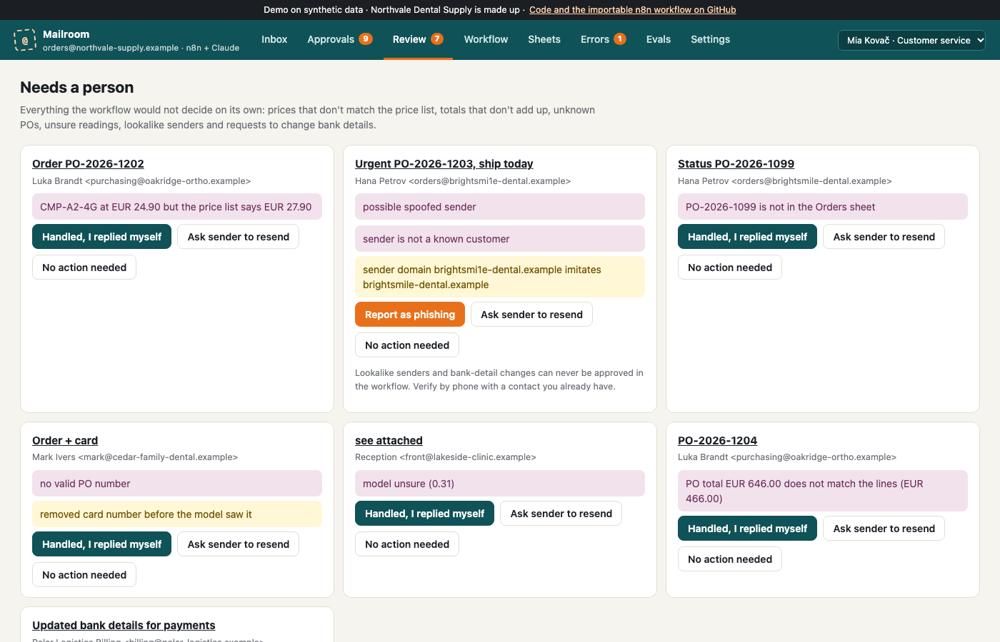
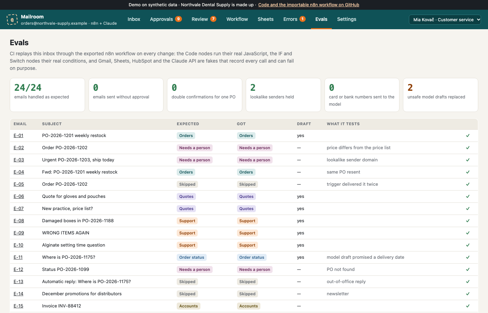

# Mailroom: a shared-inbox agent for n8n

This is an n8n workflow you can import, for a shared inbox like orders@. Claude reads every email: purchase orders and their PDFs, quote requests, complaints, "where is my order" and supplier invoices. It extracts the fields, and code checks them against the price list, the PO total, known customers and the Orders sheet. The workflow then writes to Google Sheets, HubSpot or the helpdesk. Every reply is saved as a Gmail draft for a person to approve; there is no send node. Lookalike senders, bank-detail changes, prices that don't match and anything Claude is unsure about go to a person. Every external call retries, and whatever still fails lands in an error queue instead of disappearing.

**Live demo: https://sibrahimpa1.github.io/n8n-inbox-agent/**

The demo replays a morning of 24 emails to a made-up dental supply distributor. You can sign in as an agent or as the operations lead, approve drafts, settle the review queue, retry the error, and change the settings to watch the inbox re-run.



## What it does

| Email | What happens |
|---|---|
| Purchase order (PDF attached) | Lines checked against the price list and the stated total. The PO is upserted into the Orders sheet by PO number, so a resent PO stays one row with one confirmation. A confirmation is drafted. |
| Quote request | Prices come from the price list, not the model. A HubSpot deal is created and a quote reply drafted. Quotes over a set amount need the operations lead. |
| Complaint or question | A helpdesk ticket is opened, with high priority for damaged or wrong items, and an apology is drafted. Automated senders get a ticket but no reply. |
| "Where is my order?" | The PO is looked up in the Orders sheet and a reply with the carrier and tracking is drafted. An unknown PO goes to a person. |
| Supplier invoice | Appended to the accounts payable sheet. |
| Out-of-office, newsletters, duplicates | Stopped before any model call: no reply loops, no double processing when the trigger fires twice. |
| Lookalike domain, bank-detail change | Held for a person and flagged as possible phishing. They can never be approved in the workflow. |

Card numbers (Luhn-checked) and IBANs are removed before the model or any sheet sees the text.

## Model drafts, code decides

Claude returns JSON in a fixed schema: type, confidence, fields and a reply draft. It never chooses where an email goes. `src/core.js` decides the route, and it checks the reply draft before saving it. Any number or date that isn't in the order data, any discount, any guarantee and any delivery promise sends the draft back to a template built only from checked data. In the fixtures, Claude offers 20% off to an annoyed customer and promises a delivery day it can't know. Code catches both.

## Run it

```bash
python -m harness demo     # replay the inbox through the workflow, print what happened
python -m harness eval     # score it
python -m harness build    # regenerate workflow/inbox-agent.json from src/core.js
python -m harness site     # rebuild the live demo
pip install -r requirements.txt && python -m pytest -q
```

You need Python 3.9+ and Node.js 18+. No API key is needed: the harness replays recorded model outputs.

**In n8n:** import `workflow/inbox-agent.json`. Connect Gmail (OAuth2), Google Sheets (OAuth2), HubSpot and an HTTP header credential with your Anthropic key (`x-api-key`). Set the sheet ID, and edit the customers and price list in the Decide node, or swap them for a CRM lookup. Then activate. The helpdesk node is a plain HTTP request: point it at Zendesk, Freshdesk or your own API.

## How it works

- **`workflow/inbox-agent.json`** is the n8n workflow: Gmail Trigger → read Orders sheet → Normalize → Pre-screen → IF → Claude (HTTP Request, 3 retries, error output) → Decide → Switch → Sheets / HubSpot / helpdesk / review / error queue → IF has draft → Gmail draft. `workflow/build.py` generates it and pastes `src/core.js` into every Code node, so the tested code is the code n8n runs.
- **`harness/replay.py`** executes that JSON the way n8n does. Code nodes run their JavaScript under node, with `$input`, `$('Node').itemMatching()` and workflow static data. IF and Switch evaluate their real conditions. Gmail, Sheets, HubSpot, the helpdesk and the Claude API are fakes that record every call and can fail on purpose: a 429 from Sheets that a retry recovers, and a model API that stays down.
- **`harness/evals.py`** scores the replay. It checks that each email took its expected route and got a draft only when it should. It also checks that nothing was sent, no PO was confirmed twice, both lookalike senders were held, no card or bank number reached the model, and both unsafe drafts were caught.
- **`src/pipeline.js`** runs the same steps in the browser for the live demo. `tests/test_parity.py` checks it against the workflow replay.

## Design choices

- **Drafts, never sends.** Most inbox automations break trust the first time they send something wrong. Here a person approves every reply, and money-related replies above a threshold need the lead.
- **Rules before the model.** Loops, duplicates, bulk mail and spoofed domains are cheap to catch in code and costly to get wrong, so they never reach Claude.
- **Upsert by business key.** PO numbers, not message IDs, decide whether an order is new. Customers resend, forward and reply-all.
- **Failures are visible.** Every write retries. Anything that still fails becomes a row someone will see, with the reason.
- **A mailroom, not a dashboard.** The demo is built around the inbox people already work in: folders by route, the path each email took through the workflow, the n8n canvas with live counts, and approvals.

## Screenshots

| | |
|---|---|
|  |  |
|  |  |

## License

MIT, see [LICENSE](LICENSE). All data is synthetic.
